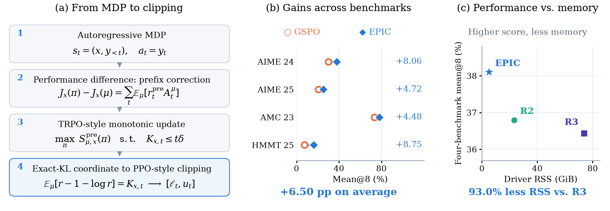
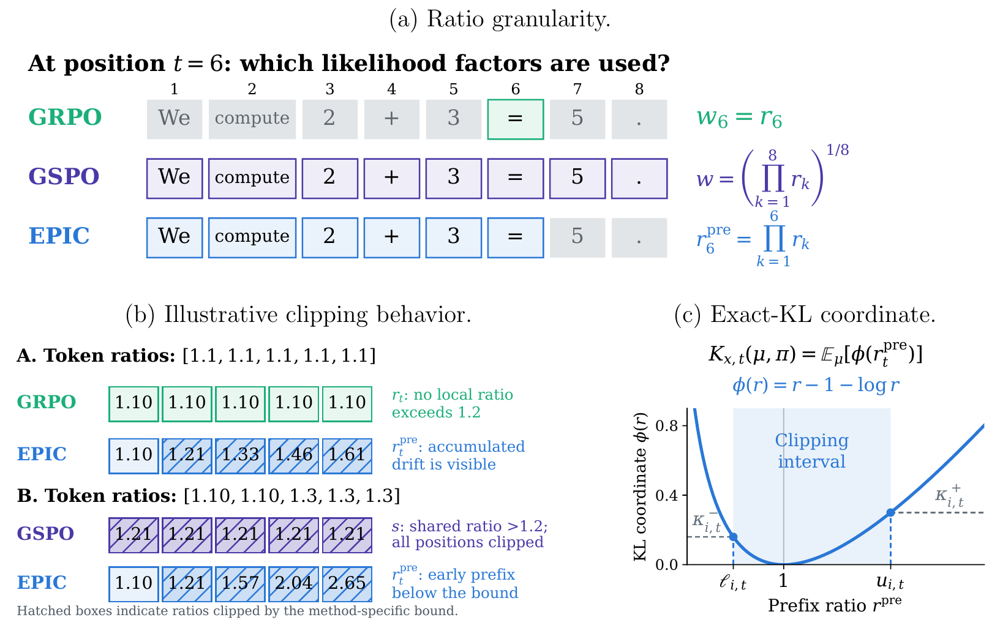
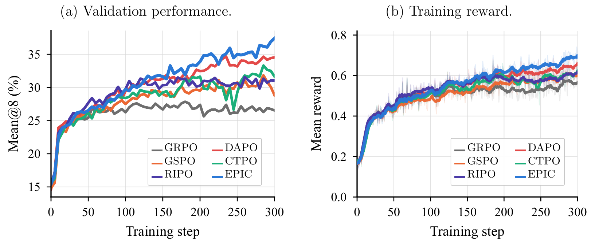

# EPIC

**EPIC (Exact-KL Prefix Importance-Ratio Clipping)** is a
[verl](https://github.com/verl-project/verl)-based method for off-policy LLM
reinforcement learning. It turns a prefix-level trust region into a practical
PPO-style clipped objective, without expert-routing replay.
On **Qwen3-30B-A3B-Base**, EPIC achieves **39.34% average mean@8** across four
math benchmarks, outperforming GSPO and GRPO by **6.50** and **10.69 percentage
points**, respectively. This repository includes the implementation,
experiment configurations, and training instructions.

## Project structure

```text
EPIC/
├── vendor/verl/          # Training framework with EPIC and baseline objectives
├── configs/              # EPIC, GRPO, DAPO, GSPO, CTPO, and RIPO configurations
├── scripts/
│   ├── run_experiment.py # Resolve configurations and launch training
│   ├── check_data.py     # Validate processed data
│   ├── demo_loss.py      # Standalone loss example
│   └── package_release.py
├── epic/                 # Standalone CPU reference implementation
├── tests/                # Loss, gradient, KL-bound, and configuration tests
├── docs/images/          # Overview, clipping mechanism, and training curves
├── DATA.md               # Model and dataset preparation
├── ENVIRONMENT.md        # Training environment and dependencies
└── IMPLEMENTATION.md     # Training code locations and implementation details
```

## Overview

A token-only ratio measures changes in the current action distribution but
misses the shift in the policy-generated context. EPIC accounts for both
with a cumulative prefix ratio. Building on the autoregressive
performance-difference identity and a TRPO-inspired prefix trust region,
it derives asymmetric clipping bounds from the exact KL coordinate
$\phi(r)=r-1-\log r$, without a local quadratic approximation.

[](docs/images/epic-overview.png)

**EPIC at a glance.** **(a)** From the autoregressive performance-difference
identity to a prefix trust region and practical clipped objective.
**(b)** Benchmark gains over GSPO in percentage points.
**(c)** Performance versus median driver-process CPU memory in the separate
routing-replay comparison (not GPU memory). Click the figure to enlarge.

In the separate routing-replay comparison, EPIC achieves competitive
performance while reducing median driver-process CPU memory by **77.5%**
relative to R2 and **93.0%** relative to R3. These reductions refer to CPU
process memory, not GPU memory or total-cluster memory.

### Prefix-level clipping

For a prompt $x$ and generated prefix $y_{1:t}$, EPIC uses

```math
r_t^{\mathrm{pre}}
=\frac{\pi_\theta(y_{1:t}\mid x)}{\mu(y_{1:t}\mid x)}
=\prod_{k=1}^{t}
\frac{\pi_\theta(y_k\mid x,y_{\lt k})}{\mu(y_k\mid x,y_{\lt k})}.
```

This is the exact change-of-measure factor for each stepwise term in the
autoregressive performance-difference identity. For policies with common
support, the behavior-policy expectation of $\phi(r_t^{\mathrm{pre}})$ equals
the KL divergence $D_{\mathrm{KL}}(\mu_{1:t}\|\pi_{\theta,1:t})$ between their
prefix distributions. EPIC uses this coordinate to construct asymmetric
prefix-ratio bounds, then implements a PPO-style clipped surrogate with
geometric-mean normalization, probability-calibrated budgets, and a
current-token-only gradient path. The exact identity motivates the clipping
design; the practical surrogate does not enforce a hard distribution-level
KL constraint.

[](docs/images/prefix-clipping.png)

**Why prefix-aware clipping is different.** **(a)** Token, response, and prefix
ratios use different likelihood factors. **(b)** With positive advantages and
illustrative bounds, EPIC detects cumulative drift missed by GRPO while
preserving early-prefix signals suppressed by GSPO. Hatched boxes indicate
clipped positions. **(c)** The behavior-policy expectation of
$\phi(r)=r-1-\log r$ equals the prefix-distribution KL divergence; coordinate
budgets determine the clipping bounds. Click the figure to enlarge.

### Main results

Off-policy training on **Qwen3-30B-A3B-Base** with an **update depth of eight**.
Scores are **mean@8 (%)**, averaged over independent runs. For each run, one
checkpoint is selected by the equal-weight average across the four validation
benchmarks; all four scores come from that same checkpoint.

| Method   | AIME 2024 | AIME 2025 |  AMC 2023 | HMMT 2025 |   Average |
| :------- | --------: | --------: | --------: | --------: | --------: |
| GRPO     |     23.61 |     16.81 |     69.48 |      4.72 |     28.65 |
| DAPO     |     31.67 |     24.03 |     76.25 |      9.86 |     35.45 |
| GSPO     |     30.00 |     20.56 |     73.44 |      7.36 |     32.84 |
| CTPO     |     30.14 |     20.97 |     76.04 |      8.75 |     33.98 |
| RIPO     |     26.94 |     21.81 |     74.69 |      8.47 |     32.98 |
| **EPIC** | **38.06** | **25.28** | **77.92** | **16.11** | **39.34** |

EPIC ranks first on all four benchmarks in this comparison. Mean@8 measures
average correctness across eight sampled responses, **not pass@8**.

[](docs/images/training-curves.png)

**Training trajectories.** **(a)** Equal-weight average validation mean@8 across
the four benchmarks. **(b)** Mean training reward. Curves average independent
runs at matching training steps under the aligned off-policy MoE setting.
EPIC's advantage becomes clearer later in training. These trajectories
complement the selected-checkpoint results above. Click the figure to enlarge.

## Getting started

### 1. Set up the environment

Prepare a Linux/CUDA environment with compatible PyTorch, Megatron, vLLM and
Ray versions as described in [ENVIRONMENT.md](ENVIRONMENT.md), then install
the included verl implementation:

```bash
git clone https://github.com/LiChengxi666/EPIC.git
cd EPIC
uv pip install --no-deps -e vendor/verl
```

### 2. Prepare the model and data

The default configuration uses Qwen3-30B-A3B-Base and DAPO-Math-17K.
Prepare the model and processed Parquet files following [DATA.md](DATA.md).
Validate the input schema with:

```bash
uv run --with pyarrow python scripts/check_data.py /shared/data
```

### 3. Configure and launch training

The default configuration uses 32 A100 GPUs across four nodes. Prepare a Ray
cluster as described in [ENVIRONMENT.md](ENVIRONMENT.md#distributed-setup);
the launcher connects to it but does not allocate nodes. First inspect the
configuration by running the command below **without `--execute`**. When the
paths, resources, and configuration are ready, launch training with:

```bash
python scripts/run_experiment.py epic \
  --model /shared/model/Qwen3-30B-A3B-Base \
  --data /shared/data --output /shared/outputs/epic \
  --ray-address auto --execute
```

Omit `--execute` to print the resolved configuration without starting training.
Use a fresh output directory. Model, data and output paths must be accessible
at the same absolute locations on all nodes.

Configs are in [`configs/`](configs/). Replace `epic` with `grpo`, `dapo`,
`gspo`, `ctpo`, or `ripo` to run a baseline. Each method has one editable
configuration; adjust it for your experiment and hardware.

### 4. Evaluate and inspect outputs

Validation is integrated into training. The default setup evaluates before
training and every five steps on AIME 2024, AIME 2025, AMC 2023 and HMMT 2025.
The metric is mean@8: average correctness over eight responses, not pass@8.

The output directory contains the resolved configuration, `metrics.jsonl`,
validation outputs and retained checkpoints. External tracking is disabled
by default. Checkpoint retention is configured under `trainer` in the JSON
configuration.

## Implementation and configuration

The training objective is implemented in
[`core_algos.py`](vendor/verl/verl/trainer/ppo/core_algos.py). The EPIC
configuration in [`configs/epic.json`](configs/epic.json) selects it with:

```yaml
actor_rollout_ref:
  actor:
    policy_loss:
      loss_mode: prefix_geometric_probability_weighted_exact_kl_dual_clip
      prefix_exact_kl_delta_low: 0.0005
      prefix_exact_kl_delta_high: 0.002
    loss_agg_mode: seq-mean-token-mean
```

Edit the JSON configuration to change the clipping budgets or other training
settings. See [IMPLEMENTATION.md](IMPLEMENTATION.md) for the registered
baseline objectives, numerical solver, gradient path, and training code
locations. The optional [`epic/loss.py`](epic/loss.py) is a standalone CPU
reference, not the distributed training entry point.

## Tests

```bash
uv run --with torch --with numpy python -m unittest discover -s tests -v
```

Tests cover loss computation, prefix gradients, KL-coordinate roots and launch
configuration checks. The optional `epic/loss.py` is a standalone CPU reference;
training uses the verl implementation.

## License

EPIC additions use **Apache-2.0**. Upstream verl notices are retained; see
[LICENSE](LICENSE) and [NOTICE](NOTICE). Models and datasets retain their own
licenses.
